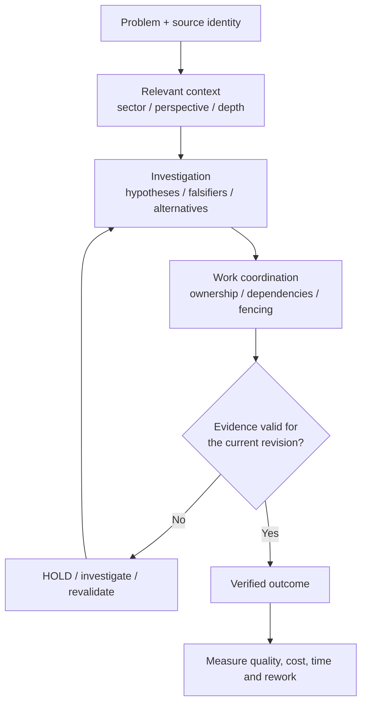

# WorkCoord — Evidence-Driven Agent Engineering

**Reliable agent work requires more than task completion.**

WorkCoord is a small, independent reference project exploring how to connect **governed context**, **structured investigation**, **exclusive work ownership**, and **verifiable evidence** in AI-assisted software engineering.

The goal is not to make agents read more, create more subtasks, or always work in parallel. The goal is to learn **when lightweight controls help teams reach valid outcomes with less avoidable rework**.

> **Status: design baseline (v0).** The architecture and evaluation protocol are public. The executable reference lab is being developed and reviewed separately. **No comparative agent-efficiency results are claimed.**

## The engineering problem

Coding agents can be productive while still failing in repeatable ways:

- an outdated note is mistaken for current implementation truth;
- two agents independently modify the same task;
- a passing test belongs to an older source revision;
- a hypothesis is treated as a verified diagnosis;
- a task is marked complete before its end-to-end behavior has been checked;
- heavy coordination adds overhead to an otherwise simple repair.

These are not all model reasoning failures. They are also **context, coordination, and evidence-contract failures**.

## The approach



**Three things remain separate:** what is known, who owns the work, and what actions are authorized. Passing a test does not grant permission to deploy. Completing an action is not automatically proof of a correct outcome.

Read the [architecture](docs/architecture.md) for the system boundaries, sectorized navigation model and trade-offs.

## A fictional incident, not a private application

The reference case is **FlowDesk**, a fictional notification service with API, queue, worker, and delivery log. A retry can produce duplicate notifications. Some experiments introduce stale notes, competing investigators, ambiguous evidence, or a source revision change.

The same incident family is evaluated under increasingly structured workflows. The question is not whether WorkCoord can win a demonstration written for it; the question is **whether its additional controls improve independently judged results enough to justify their cost**.

The scenarios are deliberately synthetic and contain no material from private projects.

## Traceable intelligence walkthrough (draft)

The [executable fictional walkthrough](docs/intelligence-walkthrough.md) begins with an old worker note suggesting producer duplication, follows a declared dependency to the queue, discovers current contradictory evidence, and revises the **provisional** investigation hypothesis:

```bash
PYTHONPATH=src python -m workcoord_lab.intelligence_demo
```

The trace exposes source revision, maturity, sector, perspective, depth, gaps, conflicting observations and reading characters. Its diagnostic signals are **human-authored annotations**, not inference by an AI model. The exercise demonstrates inspectability, not a measured reasoning or productivity improvement.

## Three-way retrieval comparison (synthetic)

The [retrieval comparison](docs/context-comparison-v0.md) tests **full corpus**, **local sector** and **dependency expansion** with the same published development rubric. Four designed cases include missing links and depth limits where selective reading fails.

```bash
PYTHONPATH=src python -m workcoord_lab.context_comparison
```

Metrics are **evidence recall**, a shared hand-annotated provisional hypothesis *proxy*, and **source-body characters read**. This is **not** a held-out agent benchmark or demonstrated productivity/token savings.

## What we will measure

| Comparison | Purpose |
| --- | --- |
| A — Strong single agent | Test whether a simpler workflow is sufficient |
| B — Basic two-agent workflow | Establish a realistic shared-work baseline |
| C — Evidence-gated two-agent workflow | Measure the incremental value of integration |

The exploratory design proposes **8 scenario families × 3 configurations × 3 repetitions = 72 planned runs**, not 72 completed runs.

We will report valid repairs, justified abstentions, invalid completions, time, tool usage, cost, and retried work. A simple task becoming slower is a meaningful negative result, not something to hide. See [experimental design](docs/experimental-design.md), [scenario catalog](evals/scenarios-v0.json), and [draft preregistration](evals/preregistration-v0.json).

**No numerical improvement is reported until actual runs, independent scoring, and limitations are published.** Deterministic invariant tests support only claims about the tested implementation, not superior LLM reasoning.

## Design principles

- **Evidence before closure:** require source-bound validation, not a persuasive summary.
- **The smallest sufficient workflow:** avoid extra agents and process when the risk is low.
- **Fencing over informal ownership:** reject stale agents after lease takeover.
- **Knowledge is not authority:** distinguish draft, observed, tested and validated information.
- **Separate scopes:** context access, task ownership and execution authorization are different.
- **Inspectability over hidden intelligence:** explicit decisions, recorded constraints and understandable failures.
- **Interoperate rather than replace:** this is not a replacement for mature orchestration frameworks or issue trackers.

## Project map

| Resource | Purpose | Maturity |
| --- | --- | --- |
| [Architecture](docs/architecture.md) | Boundaries and contracts | Design |
| [Intelligence walkthrough](docs/intelligence-walkthrough.md) | Synthetic sector/perspective/depth navigation | Executable draft |
| [Retrieval comparison](docs/context-comparison-v0.md) | Full/local/expanded context and negative cases | Public development fixture |
| [Research method](docs/research-method.md) | Hypotheses, falsifiers and evidence | Design |
| [Experimental design](docs/experimental-design.md) | Comparison plan, metrics and validity threats | Draft, not preregistered |
| [Scenario catalog](evals/scenarios-v0.json) | Eight fictional scenario families | Draft |
| [Preregistration](evals/preregistration-v0.json) | Proposed experimental parameters | Draft, not sealed |
| [Publication policy](docs/publication-policy.md) | Scope and confidentiality controls | Policy |

## Relationship to context engineering

The [LLM Context Engineering Playbook](https://github.com/leorod123/llm-context-engineering-playbook) explores which information a coding agent should trust and retrieve. WorkCoord explores a separate question: **how context becomes accountable investigation, coordinated work and validated outcomes**. Either idea can be understood independently.

## What this project is not

It does **not** claim to have invented leases, retrieval, task graphs, or multi-agent orchestration. It does not run production actions or require a hosted model. Experimental mechanisms will be labeled as such; proposed features will not be described as implemented.

For discussion in Portuguese, see [README-pt.md](README-pt.md).

## Status and next milestone

This draft PR stack contains the fictional Python + SQLite coordinator and a **sectorized context-navigation walkthrough**. Both have deterministic tests, but neither demonstrates production security, authenticated real-world sources or improved agent performance. Next: move from public development-fixture retrieval metrics to real-agent decision evaluation on fresh held-out cases, including missing counterevidence and total cost. See the [adversarial review response](docs/reviews/adversarial-response-v0.md).

**License:** To be selected by the repository owner before redistribution is explicitly permitted.
