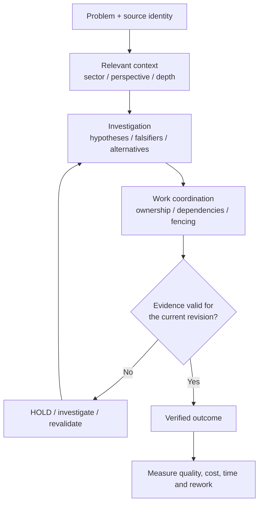

# WorkCoord — Evidence-Driven Agent Engineering

**Reliable agent work requires more than task completion.**

WorkCoord is a small, independent reference project exploring how to connect **governed context**, **structured investigation**, **exclusive work ownership**, and **verifiable evidence** in AI-assisted software engineering.

The goal is not to make agents read more, create more subtasks, or always work in parallel. The goal is to learn **when lightweight controls help teams reach valid outcomes with less avoidable rework**.

> **Status: design baseline (v0).** The architecture and evaluation protocol are public. The executable reference lab is being developed and reviewed separately. **No comparative agent-efficiency results are claimed.**

## The engineering problem

Coding agents can be productive while still failing in repeatable ways:

- an outdated note is mistaken for current implementation truth;
- two agents independently modify the same task;
- a passing test belongs to an older source revision;
- a hypothesis is treated as a verified diagnosis;
- a task is marked complete before its end-to-end behavior has been checked;
- heavy coordination adds overhead to an otherwise simple repair.

These are not all model reasoning failures. They are also **context, coordination, and evidence-contract failures**.

## The approach



**Three things remain separate:** what is known, who owns the work, and what actions are authorized. Passing a test does not grant permission to deploy. Completing an action is not automatically proof of a correct outcome.

Read the [architecture](docs/architecture.md) for the system boundaries, sectorized navigation model and trade-offs.

## A fictional incident, not a private application

The reference case is **FlowDesk**, a fictional notification service with API, queue, worker, and delivery log. A retry can produce duplicate notifications. Some experiments introduce stale notes, competing investigators, ambiguous evidence, or a source revision change.

The same incident family is evaluated under increasingly structured workflows. The question is not whether WorkCoord can win a demonstration written for it; the question is **whether its additional controls improve independently judged results enough to justify their cost**.

The scenarios are deliberately synthetic and contain no material from private projects.

## Traceable intelligence walkthrough (draft)

The [executable fictional walkthrough](docs/intelligence-walkthrough.md) begins with an old worker note suggesting producer duplication, follows a declared dependency to the queue, discovers current contradictory evidence, and revises the **provisional** investigation hypothesis:

```bash
PYTHONPATH=src python -m workcoord_lab.intelligence_demo
```

The trace exposes source revision, maturity, sector, perspective, depth, gaps, conflicting observations and reading characters. Its diagnostic signals are **human-authored annotations**, not inference by an AI model. The exercise demonstrates inspectability, not a measured reasoning or productivity improvement.

## Three-way retrieval comparison (synthetic)

The [retrieval comparison](docs/context-comparison-v0.md) tests **full corpus**, **local sector** and **dependency expansion** with the same published development rubric. Four designed cases include missing links and depth limits where selective reading fails.

```bash
PYTHONPATH=src python -m workcoord_lab.context_comparison
```

Metrics are **evidence recall**, a shared hand-annotated provisional hypothesis *proxy*, and **source-body characters read**. This is **not** a held-out agent benchmark or demonstrated productivity/token savings.

## Adaptive evidence escalation (development candidate)

A fourth scripted strategy builds on the prior [retrieval comparison](docs/context-comparison-v0.md): choose **STAY**, **DEEPEN**, **EXPAND**, or **HOLD** depending on current evidence, declared links, permitted depth and a preassigned risk tier.

The [adaptive study](docs/adaptive-evidence-v0.md) includes a deliberately **avoidable HOLD** (missing dependency) and an indistinguishable **paired-world** test where guessing either cause would be unjustified.

```bash
PYTHONPATH=src python -m workcoord_lab.adaptive_eval
```

Its evaluator is **separate from the selectors but public in this repository**. These are hand-authored test scenarios, not a protected held-out study or a claim of intelligent reasoning.

On the seven public development cases, the adaptive policy produced **three evidence-supported provisional labels**, **two justified access-limited HOLDs**, **one avoidable HOLD** and **one budget-limited HOLD**. It read **3,161** source-body characters versus **2,522** for fixed dependency expansion and **6,001** for the full corpus comparator. See the [case-by-case results and negative findings](docs/adaptive-evidence-results-v0.md). These are *not* measures of intelligence or total agent cost.

## Research Quality v0 — scientific admission without overclaiming

A new [executable, independent research-admission check](docs/research-quality-v0.md) evaluates **eight general failure domains**: source and time integrity, outcome leakage, proxy validity, falsification, evidence origin dependence, and unsupported claim promotion.

It keeps small `QUICK` investigations lightweight, while `STRUCTURED` and `CRITICAL` studies require progressively stronger evidence. A successful check means only **DESIGN_ADMISSIBLE**, **not** a scientifically validated hypothesis, independent review, or execution authority.

```bash
PYTHONPATH=src python -m workcoord_lab.research_quality_suite
```

The **14 fictional public cases** include late preregistration, unavailable evidence, stale notes, duplicate source groups, negative controls and a simple low-risk example where additional process would be unnecessary. These are *development fixtures*, not empirical agent-performance results.

## Problem & Decision v0 — a green test is not semantic closure

The [independent fictional problem-decision reference](docs/problem-decision-v0.md) separates the **problem definition**, its hierarchical **mandatory acceptance criteria**, the **choice of remedy**, the **implementation plan**, and **external proof**.

In its core negative case, every declared technical test is green and the technical task says `DONE`, but a required behavior observation is missing. The result is **HOLD**, not a completed problem.

The optional `QUICK` route avoids forcing a full alternatives matrix on simple work. For structured proposals, declared upfront, recurring, risk and rework costs are compared over the same horizon; a new component cannot silently bypass cheaper feasible reuse without an explanation. These are fictional cost assumptions, **not measured savings**.

```bash
PYTHONPATH=src python -m workcoord_lab.problem_decision_suite
```

Passing this check can at most create a *candidate for independent acceptance*; it never validates external evidence, authorizes a change or proves the repair worked.

## Cognitive Perspectives v0 — one problem, four consultative lenses

A new [executable fictional cognitive review](docs/cognitive-perspectives-v0.md) separates **technical sectors** (where evidence was generated) from **cognitive perspectives** (which question it answers). Research, Engineering, Efficiency and Risk all inspect the **same issue and proposal**, producing one source-linked checkpoint.

One challenging lens cannot be outvoted by three supporters. Stale or missing reviews, unavailable sources and unresolved questions produce an explicit **HOLD**, never an invented consensus. Low-risk `QUICK` work can avoid mandatory four-lens overhead.

```bash
PYTHONPATH=src python -m workcoord_lab.cognitive_perspectives_suite
```

All **19 scenarios are public, fictional, human-authored development fixtures**. No four-agent system, independently verified evidence, measured model benefit, or execution authority is claimed.

The [executed synthetic-development results](docs/cognitive-perspectives-results-v0.md) include explicit disagreement, missing and stale evidence, low-risk shortcut cases and the required external-review boundary.

## Knowledge & Learning v0 — source changes must invalidate conclusions

A new [self-contained fictional knowledge genealogy](docs/knowledge-genealogy-v0.md) preserves **immutable source revisions, negative evidence, claim dependencies and review receipts** in one hash-chained, replayable event history.

Its central case makes the boundary visible: an advisory conclusion was once eligible at revision `r1`, but when the source is explicitly superseded by `r2`, it becomes **HOLD_STALE_BASIS**. New positive evidence does not silently restore it; an explicit new review is required. Dependent conclusions can also become invalid even after upstream evidence is repaired.

```bash
PYTHONPATH=src python -m workcoord_lab.knowledge_genealogy_suite
```

The 19 cases are **public authored toy examples**, not proof of real agent learning, source authenticity or improved outcomes. Hashes detect content changes relative to the supplied chain; they are **not third-party signatures** or independent proof.

The [executed synthetic-development results](docs/knowledge-genealogy-results-v0.md) report both advisory recoveries and deliberately unresolved states; they do not measure learned model behavior or net efficiency.

## Minimal vertical evidence chain — late counterevidence still blocks

The [integrated fictional walkthrough](docs/vertical-evidence-v0.md) now calls the **existing** Research Quality, Problem & Decision, Cognitive Perspectives and Knowledge Genealogy evaluators over **the same issue, proposed remedy, source revision and body digest**.

At an initial historical cut, all four stages can be locally favorable and the technical tests green; a later source-linked negative observation changes the result to **HOLD_KNOWLEDGE**. A subsequent source revision requires **all** earlier stages to be reconsidered even if Genealogy alone is re-reviewed. No real task closure, source authentication, production authorization or agent performance benefit is claimed.

```bash
PYTHONPATH=src python -m workcoord_lab.vertical_integration_suite
```

There is **no new coordinator, service, database or agent**. The examples are open, synthetic fixtures with deliberately negative cases and a low-overhead QUICK path.

See the [executed synthetic integration results](docs/vertical-evidence-results-v0.md) for the 21 historical-cut classifications, exact CI receipts, regression tests and remaining scientific limitations.

## Independent audit remediation (A01-A05)

The [adversarial audit response](docs/reviews/independent-audit-remediation-v0.md) fixes five concrete contract gaps: rejected actors must not poison a lease clock; historical receipts must not depend on future events; unread sources must not reveal their diagnostic stance; unused historical background must not trigger unnecessary HOLDs; and a supporting perspective cannot silently hide unresolved counterevidence.

Shared-SQLite reads are locked; CI uses least-privilege permissions and official Actions pinned to verified SHAs. A host may inject a trusted clock source; the caller-supplied fallback remains **synthetic and untrusted**. These are deterministic reference fixes, **not** production security or demonstrated agent advantage.

```bash
PYTHONPATH=src python -m unittest discover -s tests -v
python scripts/verify_audit_mutations.py
```

## What we will measure

| Comparison | Purpose |
| --- | --- |
| A — Strong single agent | Test whether a simpler workflow is sufficient |
| B — Basic two-agent workflow | Establish a realistic shared-work baseline |
| C — Evidence-gated two-agent workflow | Measure the incremental value of integration |

The exploratory design proposes **8 scenario families × 3 configurations × 3 repetitions = 72 planned runs**, not 72 completed runs.

We will report valid repairs, justified abstentions, invalid completions, time, tool usage, cost, and retried work. A simple task becoming slower is a meaningful negative result, not something to hide. See [experimental design](docs/experimental-design.md), [scenario catalog](evals/scenarios-v0.json), and [draft preregistration](evals/preregistration-v0.json).

**No numerical improvement is reported until actual runs, independent scoring, and limitations are published.** Deterministic invariant tests support only claims about the tested implementation, not superior LLM reasoning.

## Design principles

- **Evidence before closure:** require source-bound validation, not a persuasive summary.
- **The smallest sufficient workflow:** avoid extra agents and process when the risk is low.
- **Fencing over informal ownership:** reject stale agents after lease takeover.
- **Knowledge is not authority:** distinguish draft, observed, tested and validated information.
- **Separate scopes:** context access, task ownership and execution authorization are different.
- **Inspectability over hidden intelligence:** explicit decisions, recorded constraints and understandable failures.
- **Interoperate rather than replace:** this is not a replacement for mature orchestration frameworks or issue trackers.

## Project map

| Resource | Purpose | Maturity |
| --- | --- | --- |
| [Architecture](docs/architecture.md) | Boundaries and contracts | Design |
| [Intelligence walkthrough](docs/intelligence-walkthrough.md) | Synthetic sector/perspective/depth navigation | Executable draft |
| [Retrieval comparison](docs/context-comparison-v0.md) | Full/local/expanded context and negative cases | Public development fixture |
| [Adaptive escalation](docs/adaptive-evidence-v0.md) | Stay / deepen / expand / HOLD, paired-world counterfactuals | Synthetic development fixture |
| [Research method](docs/research-method.md) | Hypotheses, falsifiers and evidence | Design |
| [Research Quality v0](docs/research-quality-v0.md) | Typed advisory admission, failure domains and negative controls | Synthetic draft |
| [Problem & Decision v0](docs/problem-decision-v0.md) | Required outcomes, semantic evidence gaps and alternatives costs | Synthetic draft |
| [Cognitive Perspectives v0](docs/cognitive-perspectives-v0.md) | Four advisory lenses, contradictions and one common checkpoint | Synthetic draft |
| [Knowledge & Learning v0](docs/knowledge-genealogy-v0.md) | Append-only revision, negative evidence and dependent claim invalidation | Synthetic draft |
| [Vertical evidence chain v0](docs/vertical-evidence-v0.md) | Four existing advisory contracts on one case; late negative invalidation | Synthetic draft |
| [Independent audit remediation](docs/reviews/independent-audit-remediation-v0.md) | Directed A01-A05 tests, reader isolation and pinned CI Actions | Synthetic draft |
| [Experimental design](docs/experimental-design.md) | Comparison plan, metrics and validity threats | Draft, not preregistered |
| [Scenario catalog](evals/scenarios-v0.json) | Eight fictional scenario families | Draft |
| [Preregistration](evals/preregistration-v0.json) | Proposed experimental parameters | Draft, not sealed |
| [Publication policy](docs/publication-policy.md) | Scope and confidentiality controls | Policy |

## Relationship to context engineering

The [LLM Context Engineering Playbook](https://github.com/leorod123/llm-context-engineering-playbook) explores which information a coding agent should trust and retrieve. WorkCoord explores a separate question: **how context becomes accountable investigation, coordinated work and validated outcomes**. Either idea can be understood independently.

## What this project is not

It does **not** claim to have invented leases, retrieval, task graphs, or multi-agent orchestration. It does not run production actions or require a hosted model. Experimental mechanisms will be labeled as such; proposed features will not be described as implemented.

For discussion in Portuguese, see [README-pt.md](README-pt.md).

## Status and next milestone

The draft PR stack contains independent public reference modules for coordination, context, investigation, scientific admission, semantic problem closure, cognitive review and knowledge genealogy, plus a minimal four-module **vertical composition**. These are **deterministic synthetic fixtures**, not production integration or proof of agent productivity. Next: independent architecture/confidentiality review and license/PR stack decision, followed by a genuinely held-out evaluation with total cost accounting. See the [adversarial review response](docs/reviews/adversarial-response-v0.md).

**License:** To be selected by the repository owner before redistribution is explicitly permitted.
