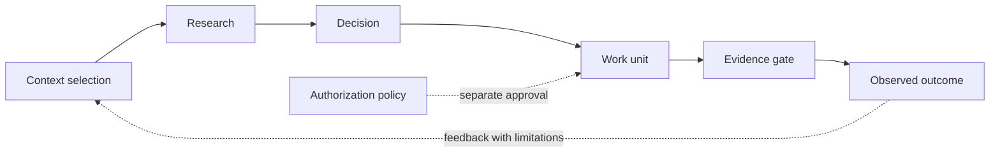

# Architecture — Context, Investigation, Work and Proof

**Maturity:** Reference design. Implementation details may evolve without changing the central separation of concerns.

## Why this boundary exists

An agent may have the right information but the wrong task, the right task but stale evidence, or a valid proposed fix without authorization to change an environment. These are different failure modes, so they need different contracts.



## Sectorized context

A candidate [executable fictional navigator](intelligence-walkthrough.md) demonstrates explicit sector/perspective/depth selection, current versus historical source revision, and traceable counterevidence under a character budget. **It is not source authentication, autonomous causal reasoning or execution authority.**


Context is selected along independent dimensions rather than injected as a large undifferentiated history:

| Dimension | Question | Example |
| --- | --- | --- |
| Sector | Which subsystem? | API, queue, worker, notification adapter |
| Perspective | Which engineering lens? | Reliability, causality, performance, security |
| Depth | How far to investigate? | Overview, focused, deep |
| Authority | Is this information reliable? | Draft, historical, observed, validated |
| Dependencies | What else may be affected? | Queue-to-worker delivery contract |
| Source identity | Which version was observed? | Pinned synthetic revision |

A selected context response should expose its source, reason for inclusion, authority, and known gaps. The selector is not permission to execute.

## Cognitive perspectives are not technical sectors

The [Cognitive Perspectives v0 reference](cognitive-perspectives-v0.md) distinguishes *where evidence came from* (API, worker, queue) from *which question should be challenged* (Research, Engineering, Efficiency, Risk). One fictional issue and one proposed remedy receive separately recorded advisory views and a **single revision-bound checkpoint**.

A dissenting risk view cannot be overruled by the number of supporting views; missing, old or causally unavailable source references appear as explicit gaps. A QUICK local check can use fewer perspectives, but additional volunteered objections are never silently ignored. This is a deterministic source-declaration contract, not independent agents, authenticated evidence, work coordination, or new execution authority.

## Research discipline

Record the question, falsifiable hypotheses, observations, contradictory evidence, cost of investigation, and the next discriminating test. For a simple low-risk task, use a lightweight route; for a high-risk dependency-heavy task, require explicit alternatives and independent review.

The agent may return **HOLD** when evidence cannot support a sound conclusion. HOLD is not automatically correct, and will be penalized when the task is resolvable.

## Three separate state dimensions

**Knowledge:** HYPOTHESIS, OBSERVED, TESTED, VALIDATED (transitions need evidence; no confidence-only promotion).

**Work:** READY, CLAIMED, SUBMITTED, VERIFIED, DONE; failure/recovery/blocked states are separate. One exclusive valid owner per unit at a time, with monotonic lease-generation fencing.

**Authority:** READ_ONLY, EDIT_SANDBOX, REVIEW_REQUIRED and explicit approval for a specifically scoped action. Neither a test pass nor a claim is a production authorization.

## Minimum work record

```json
{
  "work_id": "incident-repair-1",
  "status": "CLAIMED",
  "owner": "agent-a",
  "generation": 2,
  "expires_at_tick": 42,
  "source_revision": "fictional-r1",
  "dependencies": [],
  "evidence_ids": [],
  "authorization_scope": "EDIT_SANDBOX"
}
```

The reference Ledger uses SQLite transactions and a **synthetic caller-provided logical clock**, with an optional host-injected `time_source`. Only **accepted transitions** advance the persisted clock; a rejected actor cannot expire another valid lease by supplying a future tick. This is not distributed clock authority, authenticated reviewer identity or a production coordinator. See the [audit remediation notes](reviews/independent-audit-remediation-v0.md).

## Problem closure is not task completion

The [independent Problem & Decision reference](problem-decision-v0.md) models a **required hierarchy of problem and acceptance criteria** separately from work-unit states. The task may be `DONE` while a required behavior probe is missing; semantic closure remains blocked. An optional unknown node stays visible without automatically forcing a low-risk route into heavyweight governance.

Alternatives are compared at a common assumed time horizon, and the application plan is distinct from choosing the remedy. This is a fictional advisory contract; the code does not independently inspect an operational system or grant a correct outcome.

## Knowledge genealogy is not authorization

The [Knowledge & Learning v0 reference](knowledge-genealogy-v0.md) makes each source revision, evidence observation, counterevidence, retraction and claim review an explicit event in a **fictional, append-only hash chain**. Historical snapshots can be replayed; a source supersession invalidates a prior accepted advisory review, and dependent conclusions are rechecked. Negative findings remain visible after retraction.

A new source revision is *staged* until an explicit supersession event; a revised basis cannot silently re-enable a claim. A later independently unverified review can restore **advisory temporal currency**, not scientific truth or production authorization. SHA-256 links synthetic event bytes but is not an external attestation or signed, trusted clock.

## Minimal vertical composition (advisory only)

The [vertical evidence-chain example](vertical-evidence-v0.md) calls the **original** Research Quality, Problem & Decision, Cognitive Perspectives and Knowledge Genealogy functions in sequence on one fictional source identity. A shared manifest binds issue, remedy, primary observation, source revision and body hash across stage inputs. Mismatches fail closed.

An observation appearing **after** an earlier history cut may invalidate its advisory conclusion without changing the earlier technical test results. Superseding a primary source revision also blocks promotion until all four earlier stages are reconsidered. No new coordinator, persistence layer, external access or permission system is created; the integrated checkpoint remains advisory.

## Decision and completion gates

1. A unit can be claimed only with an unexpired, uniquely fenced lease.
2. Submission includes a source-bound test artifact. The artifact must be verifiable in a stronger future integration; self-asserted markers are not independent proof.
3. Prerequisite units must be complete before dependent work can be verified.
4. Verification and authorization are independent. Explicit review is needed when the scope requires it.
5. Final completion is idempotent and leaves an inspectable event receipt.

## Limits and non-goals

This project does not implement a hosted service, production runtime, real authorization backend or general-purpose agent scheduler. Initial synthetic components are teaching and test fixtures. Correctness claims remain limited to the exact invariants and test environment exercised.
