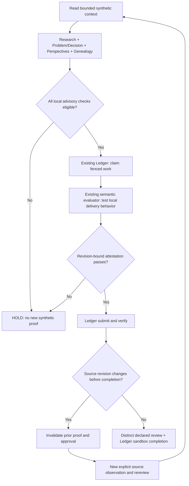

# Ledger End-to-End v0 — One Fictional Problem, Revision-Bound Proof

> **PUBLIC, SYNTHETIC AND SELF-SCORED DEVELOPMENT EXAMPLE.** Not a live agent, not a trusted source of time or identity, not a production deployment and not evidence that an autonomous system fixes software better or cheaper.

## What this closes (and what it does not)

Earlier [Vertical Evidence v0](vertical-evidence-v0.md) linked Research Quality, Problem & Decision, Cognitive Perspectives and Knowledge Genealogy over a shared synthetic source manifest. Those were advisory functions, deliberately **not** work ownership. The separate [Ledger](reference-lab.md) already supported lease fencing, status transitions, SQLite transactions, synthetic evaluator receipts, revision changes and explicit approval.

This demonstration **reuses those existing implementations together**. It also invokes the existing [ContextNavigator](intelligence-walkthrough.md), which must actually read a revision-matched primary source body within a character budget. The decisive end state is `DONE` **only inside the fictional Ledger**, after the synthetic behavioral oracle and a distinct *declared* reviewer label. No existing stage becomes an authenticated actor, a source of scientific truth or an independent production authority.

No new coordinator, agent runtime, model call, database server, service or payment/deployment integration is introduced.

## One reference path, two explicit source revisions



The public [fixture](../examples/ledger-vertical-fixture-v0.json) starts with the authored **VI01** base packet and a separately authored selected context document. It then provides **37 explicit JSON patch operations** for a new `fictional-r3` source with a **different source body hash** and four append-only genealogy actions: source registration, supersession, new positive observation, and a new `REVIEW_ACCEPT`. This patching is only **development fixture assembly**, not automatic promotion or silent re-binding of real-world sources.

| Phase | Existing stage behavior | What is forbidden |
| --- | --- | --- |
| `fictional-r2`, genealogy cut 4 | Bounded navigation reads the primary observation; four advisory gates produce `ADVISORY_CANDIDATE_FOR_EXTERNAL_ACCEPTANCE` | A retrieved hypothesis is not a verified repair |
| Negative delivery observation | Existing semantic delivery oracle reports a duplicate | Failing behavioral proof may not be recorded as a passing submission |
| Original claim and source-bound attestation | The Ledger advances through CLAIMED → SUBMITTED → VERIFIED; a separate reviewer label is recorded | Wrong-owner / wrong-generation submission, expired lease, unreviewed completion |
| Source supersession to `fictional-r3` | Prior evidence and approval are cleared; Ledger returns to CLAIMED without granting a new generation | Old receipts, old source revision, or old review cannot be reused |
| Old four-stage packet + new genealogy cut | `HOLD_REASSESS_REVISION` even if genealogy has newer positive evidence | A revised genealogy cannot silently validate old Research/Problem/Cognitive inputs |
| New r3 packet at cut 7 | `HOLD_KNOWLEDGE` because a new observation lacks an explicit review | Mere receipt of a new file is insufficient |
| Explicit fresh r3 packet at cut 8 | Source hash and revision match a **newly read** context document; advisory gates are again locally eligible | The result is not external independent acceptance |
| New r3 behavioral receipt and review | A new synthetic oracle proof supports submit/verify; review and complete lead to local Ledger DONE | Direct production approval, model training or authenticated human identity |

**Separate negative case:** VI01 cut 6 adds a **CHALLENGE** after initially favorable technical/advisory checks. The same bridge must now return HOLD at submission, verification and completion instead of allowing a prior positive result to erase the late counterexample.

## The public checks

```bash
PYTHONPATH=src python -m workcoord_lab.ledger_vertical_e2e --output artifacts/ledger-vertical-e2e-v0.json
PYTHONPATH=src python -m unittest discover -s tests -v
python scripts/verify_ledger_vertical_mutations.py
```

The runner prints a small summary and writes a JSON report with the fixture SHA-256, four stage/admission checkpoint identities, context reading character counts, old/new revision-bound **artifact SHA-256s**, sanitized Ledger **event types** (not raw event payloads), local DONE receipt, event chain check and negative-control outcomes. These are deterministic classifications of an authored fixture, not externally scored success.

The module uses **`secrets.token_bytes(32)` only inside runtime memory** as the synthetic HMAC test key. No model provider API key, private fixture key, raw HMAC, key-dependent event-chain head or private tool response is written to the repository or emitted in the JSON receipt. Since the ephemeral key varies per run, raw signed event digests are intentionally **not** claimed to be byte-for-byte deterministic. The public *redacted* summary is reproducible.

Targeted tests cover cross-stage issue/revision/source hashes; mandatory selected source rather than mere corpus presence; stale context; hard character budget; late contradictory evidence; missing explicit genealogical rereview; changed-source invalidation of proof and approval; rejected wrong actor; bad delivery oracle; review required even after green tests; no secret serialization; and other bridge bypasses.

New deliberately broken versions **M96–M106** attempt to drop these guards, each requiring a named assertion failure. Existing mutation controls M1–M95 remain part of CI.

## Exact authority limits — important

- **No real agent is involved.** All decisions, documents, source revisions, estimated costs and review identities are author-written. The delivery oracle checks only a fictional **one-delivery-per-distinct-event** property over provided strings, not an external notification service.
- **A local Ledger DONE is not Problem & Decision semantic closure.** That module still declares `semantic_closure_granted=false`; the vertical gate is **advisory** and has no independently authenticated behavioral result. The synthetic behavior oracle is a distinct, scoped test.
- The bridge recomputes the supplied **current** advisory packet and checks its source revision against the Ledger at each phase. It **cannot discover a new real source revision by itself** and has no trusted shared clock. A malicious client bypassing this cooperative bridge can call the Ledger's general-purpose APIs directly. Therefore this is not an enforced security boundary inside the Ledger.
- Source identities, reviewers, claimed HMAC attestation origins, policy scopes and logical ticks are **not authenticated in production**. The host-provided time source here is a test-owned callback. It is not a trusted network clock.
- The content hash binds fictional source text **within the supplied packet and selected context**, not its truth. Chain hashes are not externally pinned or timestamped. A raw MAC from the random local key is not an independent third-party signature.
- The `REVIEW_REQUIRED` label ensures a distinct reviewer *string* for the local reference. It does **not** certify a real human or a cryptographically distinct principal, nor confer production action authority. No service is deployed.
- Context “cost” counts characters read, not measured tokenizer usage, latency, dollars, retries or agent productivity. This must not be described as a measured cost improvement.
- CI and receipts are public synthetic development controls, **not hidden/held-out benchmarks**.

## Next research boundary

The next planned independent evaluation should run in a public sandbox/benchmark (for example Harbor + Terminal-Bench and an appropriate software repair corpus) with a separately held evaluator, frozen task list, comparable models/tool budgets and explicit total cost. A Codex/OpenAI API, if used later, must be accessed through approved connector/secret management and never copied into this public repository, workflow YAML, published trajectory or fixture. Human review of provenance, license and the stacked draft PRs remains a prerequisite to distributing this as reusable software.
