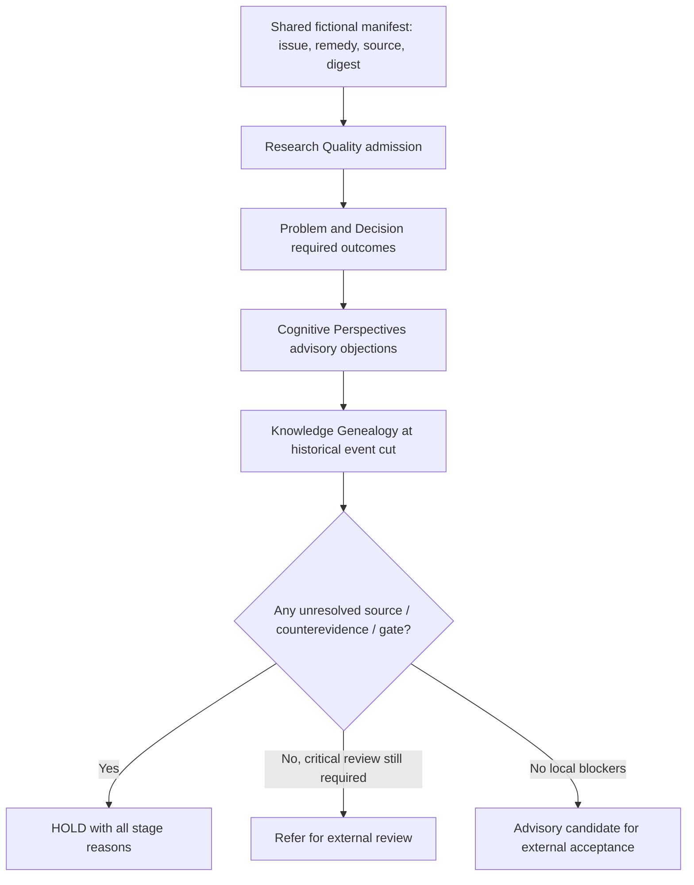

# Minimal Vertical Evidence Chain v0 — One Incident, Four Existing Contracts

> **PUBLIC FICTIONAL DEVELOPMENT DRAFT.** This is an *advisory composition*, not a new coordinator, autonomous agent, persistent workflow, cryptographic trust root, scientific verification or proof of real-agent productivity.

## Why integrate?

A stack of four independently green modules can still mislead if each evaluates a different problem, a different source revision or a different proposed remedy. The [Research Quality](research-quality-v0.md), [Problem & Decision](problem-decision-v0.md), [Cognitive Perspectives](cognitive-perspectives-v0.md) and [Knowledge Genealogy](knowledge-genealogy-v0.md) references already have individual tests. This demonstration **calls their original evaluators**, without copying or replacing any of their decision rules.

A small manifest binds **the same fictional incident** through all four:

- `issue_id` and `proposal_id`, including the selected remedy in Problem & Decision;
- `source_revision`, `primary_source_id` and `source_lineage`;
- `primary_observation_id`, `claim_id` and **SHA-256 of the literal primary source body**;
- `risk`, which may be `QUICK`, `STRUCTURED` or `CRITICAL`.

The primary content digest must match the Research observation text, the cited Cognitive source text, the Genealogy source body and its primary supporting observation. Problem & Decision shares the exact observation ID and revision but **has no independently authenticated body**; its witness kind/result are checked by its own original module. This is a useful boundary to preserve explicitly.

A mismatch is **rejected**, never silently reinterpreted as a favorable case. Additional historical sources or independent counterevidence may appear after the original review.

## Sequence



Each original function executes on its original typed packet. The small vertical evaluator accepts their **declared evidence**, checks cross-stage identity and source revision, and returns a source-bound report. It cannot verify any external file or take an action. A green technical test **never** becomes a verified problem closure or permission to deploy.

## The decisive example (VI01)

The same input bundle is evaluated at two strictly ordered genealogy cuts:

| Knowledge event cut | Research | Problem | Cognitive | Genealogy | Final advisory result |
| --- | --- | --- | --- | --- | --- |
| **4** | `DESIGN_ADMISSIBLE` | `CANDIDATE_FOR_EXTERNAL_ACCEPTANCE` | `ADVISORY_READY` | `ADVISORY_CURRENT` | `ADVISORY_CANDIDATE_FOR_EXTERNAL_ACCEPTANCE` |
| **6** | Unchanged | Unchanged; technical tests still green | Unchanged; initial lenses still favorable | **`HOLD_COUNTEREVIDENCE`** | **`HOLD_KNOWLEDGE`** |

A fictional delivery-trace source is added at event 5, and an explicit counter-observation is appended at event 6. The later observation is **not visible** at event cut 4. The original individual stage receipts remain identical; only the genealogy and vertical checkpoint digests change. The final result cannot use earlier green checks to erase a later contradiction.

This is *not* an authenticated observation, real-world causal inference, proof that a notification bug was repaired, or an actual authorized completion. Even cut 4 is **only a candidate for later independent acceptance**.

## Two additional barriers

**Source epoch (VI03/VI04):** when a new source revision is explicitly promoted, the old Research/Problem/Cognitive packets remain pinned to their earlier revision. Even if a new genealogy review makes its own claim `ADVISORY_CURRENT`, the vertical status remains `HOLD_REASSESS_REVISION` until all four earlier stages are re-evaluated on matching source identity. No silent rebind, no historical rewriting.

**Independent gates (VI05–VI11):** a missing required behavior witness, absent falsifier, outcome peeking, a missing or uncertain cognitive perspective, or a critical external-review requirement each blocks the combined conclusion on its own. A `QUICK` scenario can use one engineering perspective and a bounded problem without requiring the full four-lens protocol.

No stage's result grants `execution_authority`. The vertical output always declares:

- `authorization: NONE`
- `work_ownership: NOT_ASSIGNED`
- `knowledge_promotion: NOT_GRANTED`
- `independent_outcome_verified: false`
- `model_learning_performed: false`
- `source_authenticity_verified: false`

## Compact, reproducible development cases

The [public case catalog](../examples/vertical-integration-cases-v0.json) contains **one transparent common packet**, 14 sets of small typed JSON patches, and four deliberately malformed compositions. Compact patches avoid shipping a separate copy of all four large records for each variation. No runtime evaluator accepts these patch commands: they are **fixture assembly operations only** (`set`, `remove`, `append`, `truncate`).

The 14 cases include: early-vs-late contradiction; retraction then mandatory rereview; source-epoch change even after a genealogy rereview; technically green but semantically open; missing falsifier and late outcome freeze; efficiency doubt or missing Risk perspective; simple QUICK; critical external review; unrelated revisions not blocking; new positive evidence triggering re-review; and simultaneous cognitive/late genealogical disagreement.

The four malformed compositions must be rejected: unrelated issue, same-length changed source text, wrong selected remedy, and a forged authorization field. No public expected labels are held out; these are **author-authored contract tests**.

## Reproduce (Python 3.10+, standard library)

```bash
PYTHONPATH=src python -m workcoord_lab.vertical_integration_suite --output artifacts/vertical-evidence-v0.json
PYTHONPATH=src python -m unittest discover -s tests -v
python scripts/verify_vertical_mutations.py
```

To inspect a single authored packet, materialize it from the catalog and run `evaluate_vertical(packet, at_seq=4)` and `evaluate_vertical(packet, at_seq=6)`. The entrypoint also supports a standalone JSON packet:

```bash
PYTHONPATH=src python -m workcoord_lab.vertical_integration my-fictional-packet.json --at-seq 6
```

The CI receipt includes the public catalog SHA-256, per-phase checkpoint SHA-256s, stage statuses, historical-cut identities, and explicitly unmeasured claims. GitHub Actions runs the test suite on Python 3.10, 3.11 and 3.13, preserving the previous mutation probes. No new database or process is introduced.

## Cost and security limits

- The stage inputs and all accepted event bytes are fictional, user-authored records. Hash equality proves byte agreement **relative to this input**, not that a file was authored or observed by a trusted entity.
- The per-stage revisions and genealogy ticks do not establish a globally trusted causal clock. The history cut applies **only** to the genealogy; the earlier stage results are pinned unchanged and must be refreshed in an actual future implementation. Source revision changes trigger a conservative re-evaluation requirement.
- The output records estimated cognitive review units and declared remedy-cost tables, **not measured total costs**. It cannot optimize cost or compare the quality of real agents.
- SHA-256 is not a digital signature. A party who can rewrite and reseal a log without an independent trusted head can forge a new history. Neither this module nor the public genealogy claims otherwise.
- The prototype does not authorize work, access operational stores, issue payments, run background services, interpret private source systems or prove a scientifically valid final outcome.

### Next independent gate

After this stack passes its own **public** deterministic tests, conduct an adversarial architectural and confidentiality review, decide the repo's license and PR merging order, then design a **separately held-out** experiment with real agents. That study must freeze an independent evaluator and source visibility, measure end-to-end valid outcomes and include **cases where review overhead yields no benefit or excessive abstention**.
